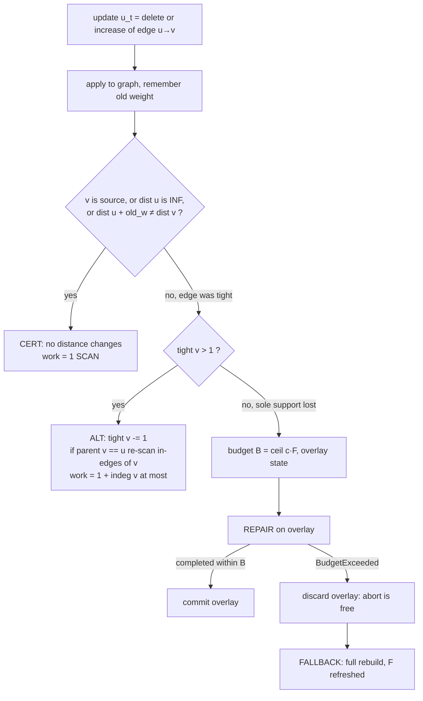
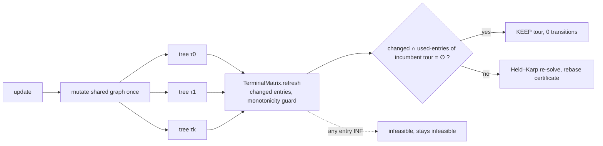
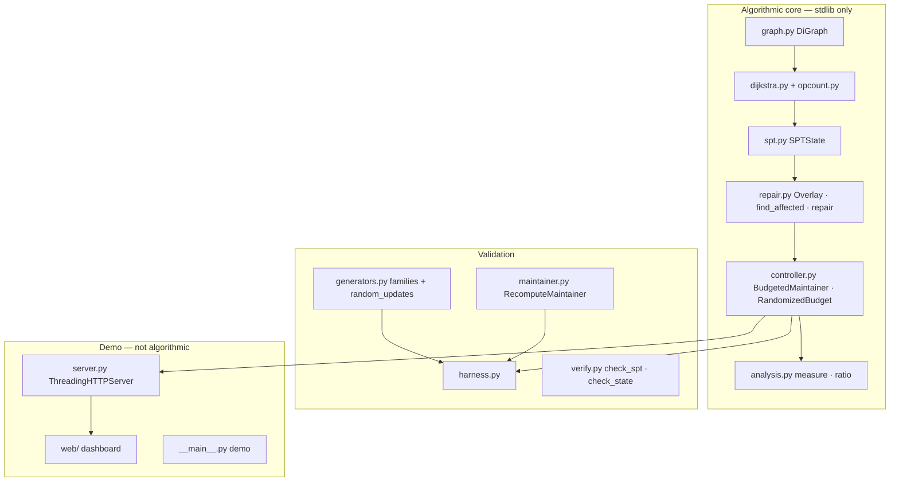

# GraphPulse-R — Technical Source of Truth

> **Purpose.** Single, technically precise record from which the IEEE/Springer paper will be written.
> It describes what the repository *actually* does, what has been *verified*, and what is still *planned*.
> It is a living document: it is updated in the same commit as any change to methodology, code, tests or results (Rule 4).
>
> **Synchronised with:** branch `phase-5-terminals` (Phase 5 complete, 2026-10-20); baseline analysis on `main` @ `0e02495`.
> **Companion documents:** [`PROJECT_LOGBOOK.md`](PROJECT_LOGBOOK.md) (chronology, decisions, experiments) · [`ANALYSIS_REPORT.md`](ANALYSIS_REPORT.md) (gate audit, status audit, roadmap) · [`SPEC.md`](SPEC.md) (frozen model and cost model) · [`proofs/`](proofs/) (P1–P3).

## Status labels (used everywhere in this document)

| Label | Meaning |
|---|---|
| **IMPLEMENTED** | Code exists on `main` and is wired in. Says nothing about correctness or performance. |
| **VALIDATED** | Implemented and checked against an independent oracle by tests that pass (re-run on 2026-10-20). |
| **EXPERIMENTALLY VERIFIED** | A seeded script produced a committed table, and the table was regenerated and matched. |
| **PARTIAL** | Some of the above holds; the gap is stated. |
| **PLANNED** | In the second-half playbook (Phases 5–8); no code exists. |
| **FUTURE WORK** | Beyond the playbook; not scheduled. |
| **PENDING EXPERIMENT** | A number the paper will need that has not been measured. **No such number appears in this document.** |

---

## 1. Title

**Working title:** *Certificate-Driven, Budgeted Reoptimization of Shortest-Path Trees, with Exact Tour Re-solving, for Dynamic Delivery Routing under Non-Decreasing Edge Weights.*

Short name: **GraphPulse-R**. The title makes no speed or optimality claim and does not call the method a "new algorithm" (see §3.5, §13, and `AGENTS.md` §4).

---

## 2. Abstract — working draft

*Delivery routes must be re-planned when roads close or slow down. We study the setting in which a directed road graph with positive integer weights receives a stream of edge deletions and weight increases, and after every update the system must hold (i) exact single-source shortest-path distances from a depot and k delivery stops, (ii) the k+1 by k+1 terminal distance matrix, and (iii) a minimum-cost single-vehicle tour. We combine three mechanisms: a structural **certificate** that proves in O(1) that an update leaves a shortest-path tree unchanged; **budgeted incremental repair**, in which repair of the affected region runs under a work cap B = ⌈c·F⌉ (F = cost of a full rebuild) and is aborted for free on a copy-on-write overlay if the cap is exceeded, after which the tree is rebuilt; and a **lazy tour certificate** that skips the exact Held–Karp solve when no matrix entry used by the incumbent optimal tour has changed. We prove that per-update work is at most (1+c)F+2 and that the competitive ratio against the per-update offline optimum min(r,F) is max(1+c,(1+c)/c), minimised at c=1 (ratio 2); a randomised budget attains e/(e−1) in expectation. The single-source layer is implemented and validated against a recompute-from-scratch oracle on 100,000 mixed updates over four graph families. The multi-terminal, routing and real-data layers, and all comparative performance claims, are **PENDING EXPERIMENT**.*

What the abstract may and may not say today:

| Statement | Status |
|---|---|
| Exactness of the single-source layer on 100,000 updates, 4 families, 5 seeds | VALIDATED (§10, V1) |
| Work bound (1+c)F+2 and ratio max(1+c,(1+c)/c) | Proved in P2/P3 for **oracle-F mode**; deployable `last`-F mode is bounded only relative to a stale F (§13, L2) |
| Large work savings over recomputation | EXPERIMENTALLY VERIFIED only for one seed, 1,000 updates/family, benign random workloads (§10, V2) |
| Multi-terminal / tour / road-network results | PENDING EXPERIMENT |
| Novelty | Integration only; literature check not yet done (Playbook 8.3) |

---

## 3. Introduction

### 3.1 Background and importance
Last-mile logistics operates on road networks whose edge costs change: closures, congestion, weather. A planner that recomputes all shortest paths and the delivery tour after every change wastes work, because most changes do not affect the current plan.

### 3.2 Existing approaches and their limitations
- **Recompute from scratch** (Dijkstra from every terminal, then a tour solver): trivially correct, work Θ(k·m log n) per update regardless of how little changed.
- **Dynamic shortest-path algorithms** (incremental/decremental SSSP): classically studied (e.g. Ramalingam–Reps style bounded-incremental repair; Even–Shiloach trees for unweighted decremental). *To be verified and cited in `RELATED_WORK.md` (Playbook 8.3); no citation is asserted here.* Their usual guarantees are asymptotic or amortised and say nothing about *when repair is worse than rebuilding*.
- **Tour solvers** treat the distance matrix as a fresh input; they do not exploit that, under monotone updates, tour costs only grow.

### 3.3 Research gap addressed
Two decisions are normally left informal: (1) *repair or rebuild?* and (2) *re-solve the tour or keep it?* GraphPulse-R makes both decisions with checkable certificates and a provable work budget, and measures cost in machine-independent operation counts.

### 3.4 Proposed approach (one paragraph)
Per terminal, keep a shortest-path tree with tight-in-edge counters. On each update run a decision cascade — certificate → alternative support → budgeted repair → rebuild fallback — then refresh the terminal matrix, then ask the lazy tour certificate whether the incumbent tour is still optimal; only if not, re-run Held–Karp.

### 3.5 Contributions (as currently defensible)
| # | Contribution | Status |
|---|---|---|
| C-1 | Exact decision cascade for monotone SSSP maintenance with O(1) structural certificate and tight-counter alternative support | VALIDATED (single source) |
| C-2 | Abort-free budgeted repair on a copy-on-write overlay with rebuild fallback | VALIDATED |
| C-3 | Work bound (1+c)F+2 and competitive ratio max(1+c,(1+c)/c); randomised budget e/(e−1) | Proved (P2, P3); measured within bound on unit/property tests (T4.3-*) |
| C-4 | Cross-layer lazy tour certificate (skip Held–Karp when no used matrix entry changed; ε-tolerant variant) | PLANNED (Phase 6.4) |
| C-5 | End-to-end evaluation in operation counts incl. adversarial tightness | PLANNED (Phase 7) |

Honest framing (from `AGENTS.md` §4): every ingredient has prior art; the claim is *integration, competitive analysis and certificates, evaluated end to end*.

---

## 4. Problem formulation

**Graph.** G₀ = (V, E₀, w₀), V = {0,…,n−1}, E ⊆ V×V simple (no self-loops, no parallel edges), w(e) ∈ ℤ⁺. Unreachable distance is +∞ (`INF = float("inf")`).

**Updates.** A sequence U = (u₁,…,u_T) with each u_t either `delete(e)` (E_t = E_{t−1}∖{e}) or `increase(e, w′)` with w′ > w_{t−1}(e). Equivalently w_t ≥ w_{t−1} pointwise with deletion as w=∞. Insertions and decreases are out of scope.

**Terminals.** T = (τ₀,…,τ_k), τ₀ the depot, distinct vertices, k ≤ 18.

**Distances.** d_t(x,y) = shortest-path length in G_t. **Tight edge** w.r.t. source s: (u,v)∈E with d_t(s,u)≠∞ ∧ d_t(s,u)+w(u,v)=d_t(s,v). `tight[v]` = number of tight in-edges. The tight subgraph is acyclic since w ≥ 1 (P1, Claim 1).

**Terminal matrix.** D_t[i][j] = d_t(τ_i, τ_j).

**Tour.** A permutation π of {1..k}; cost C_t(π) = D_t[0][π₁] + Σ_{r<k} D_t[π_r][π_{r+1}] + D_t[π_k][0]. Optimum C*_t = min_π C_t(π); +∞ if no finite tour exists.

**Required output after each update t:** d_t(τ_i,·) for all i; D_t; (C*_t, π*_t).

**Objective.** Minimise Σ_t work_t where work = SCAN + PUSH + POP + QUEUE (SPEC §4), subject to exactness (outputs equal those of recomputation).

**Monotonicity lemma (informal; formalised in P5, PLANNED).** Since w_t ≥ w_{t−1}, d_t ≥ d_{t−1} pointwise, hence D_t ≥ D_{t−1} and C_t(π) ≥ C_{t−1}(π) for every π. Consequently if C_t(π*_{t−1}) = C*_{t−1} then π*_{t−1} remains optimal. This is the whole basis of the lazy tour certificate.

**Competitive model (P3).** For an update that removes the sole tight in-edge of v, let r = cost of a complete repair, F = cost of a full rebuild on the updated graph, OPT = min(r,F). The online algorithm does not know r in advance.

---

## 5. Proposed methodology

### 5.1 WHY → WHAT → HOW

| Why | What | How | Status |
|---|---|---|---|
| Most updates cannot change any shortest path | A *certificate* that proves "unchanged" without recomputation | If (u,v) not tight: 1 SCAN. If tight but `tight[v]>1`: decrement counter, re-parent if needed | VALIDATED |
| When distances do change, usually few vertices do | *Incremental repair* confined to the affected set A | Find A by counter propagation; local Dijkstra inside A seeded from boundary | VALIDATED |
| Repair can cost more than rebuilding | A *budget* with free abort and a rebuild fallback | Cap B=⌈c·F⌉ on an overlay; `BudgetExceeded` ⇒ discard overlay, rebuild | VALIDATED |
| Many trees share one graph | *Multi-terminal manager*, one tree per terminal, one graph mutation per update | Split "mutate graph" from "handle update" | PLANNED (5.1–5.2) |
| The tour depends only on k² matrix entries | *Lazy tour certificate* | Keep tour if no used entry changed; optional ε-keep with a stored lower bound | PLANNED (6.4) |
| Exact tours are NP-hard | Exact solver only for small k | Held–Karp, k ≤ 18; branch-and-bound and nearest-neighbour as baselines | PLANNED (6.1–6.3) |

### 5.2 Per-update workflow (single source — IMPLEMENTED)



### 5.3 Decision logic and fallbacks
- Order is fixed: certificate → alternative support → repair → fallback (`controller.py:194-342`).
- **Only `BudgetExceeded` triggers a fallback**; every other exception propagates (AGENTS §5).
- `verify=True` runs the structural checker after every update (fault detection, not part of the algorithm).
- **F estimation:** `f_mode="oracle"` measures F_true by rebuilding on a scratch copy (needed for the proofs; *not charged* to online cost, hence not deployable); `f_mode="last"` uses F from the last rebuild (deployable; stale-F effect in L2).
- **Budget:** deterministic ⌈c·F⌉ (c=0 ⇒ never repair, c=∞ ⇒ never fall back) or randomised ⌈x·F⌉ with x = ln(1+(e−1)U).

### 5.4 Planned extension (Phases 5–6)

Each tree keeps its own F and budget (no sharing). *PLANNED.*

---

## 6. Algorithm design

Notation: n=|V|, m=|E|, deg⁺/deg⁻ out/in-degree, A = affected set, vol(S)=Σ_{x∈S} deg(x).

### Alg-1 Counted Dijkstra — VALIDATED
- **Purpose:** baseline and rebuild primitive. **Input:** DiGraph g, source s, OpCounter. **Output:** `dist[]`, `parent[]`.
- **Method:** lazy-deletion binary-heap Dijkstra; PUSH only on strict improvement, POP on every extraction (stale included), SCAN per out-edge of a *settled* vertex.
- **Correctness:** textbook (non-negative weights). Cross-checked against `networkx` oracle tests (commit `711ed27`, `test_verify.py`, `test_dijkstra.py`).
- **Invariants:** `push == pop` at termination; `scan = Σ deg⁺` over settled vertices.
- **Complexity:** time O((n+m) log n); work ≤ m + 2(m+1) ≤ 3m+2 (derived, not yet a committed test). Space O(n).
- **Mapping:** `dijkstra.py:dijkstra`, `opcount.py`. **Limitations:** list-copying `out_edges()` adds hidden constant overhead in wall-clock (not in op-count).

### Alg-2 SPT state build with tight counters — VALIDATED
- **Purpose:** produce the repairable state and define F. **Output:** `SPTState{dist,parent,children,tight,F_ops}`.
- **Method:** Dijkstra, then for each reachable v≠s scan `in_edges(v)` to count tight predecessors; `parent[v] = min(tight preds)` (deterministic); `children` inverted from `parent`.
- **Definition:** F = Dijkstra work + Σ_{v reachable, v≠s} deg⁻(v) ≤ (3m+2) + m = 4m+2 (derived).
- **Invariants (checked by `check_state`):** `tight[s]=0`; `tight[v]=0` iff unreachable; `tight[v]≥1` for reachable v≠s; `parent[v]∈ tight preds`; `children` is the exact inverse of `parent`.
- **Key property (empirical, see §10 V3):** the state is *canonical* — a function of (G, s) only, because parent is the minimum tight predecessor. Repaired state therefore equals rebuilt state, which is what lets P3 treat each update's repair-vs-rebuild decision independently. **PARTIAL:** checked by an ad-hoc script on 14,400 states (0 differences); not yet a committed test; P3 does not state it as a lemma.
- **Mapping:** `spt.py:SPTState.build`. **Complexity:** time O((n+m) log n), space O(n+m).

### Alg-3 Certificate and alternative support — VALIDATED
- **Input:** old distances, old weight of (u,v), update. **Output:** strategy `cert` or `alt`, or "needs repair".
- **Method:** (u,v) is non-tight ⇔ `v==s ∨ dist[u]=INF ∨ dist[u]+old_w≠dist[v]` ⇒ no distance changes (a non-tight edge lies on no shortest path, and weights only grow). If tight and `tight[v]>1` ⇒ `dist[v]` unchanged; `tight[v]−=1`; if `parent[v]==u`, scan `in_edges(v)` and re-parent to min tight predecessor.
- **Correctness:** P1 (alternative tight support keeps distance; INF guard). **Work:** cert = 1; alt ≤ 1+deg⁻(v).
- **Mapping:** `controller.py:215-284` (and duplicate in `repair.py:RepairMaintainer.apply`, see L7). **Limitation:** the tight-counter test is exact only because weights are integers (no float equality).

### Alg-4 Affected-set identification (`find_affected`) — VALIDATED
- **Purpose:** compute A = {x : dist_old[x] ≠ dist_new[x]} for an update that removed the sole tight support of v.
- **Method:** BFS from v over *old-tight* out-edges using a scratch copy of `tight[]`; a vertex joins A when its scratch tight count reaches 0.
- **Correctness:** by induction on dist order using the tight DAG (P1): x∈A ⇔ every old tight in-edge of x originates in A∪{removed edge}. Verified against a Dijkstra oracle on 500 Hypothesis cases (T3.3-06; deletions on n≤9 graphs only — see L8) and 5×20,000-update differential runs.
- **Work:** scan = vol⁺(A), queue = 2|A|. **Space:** O(|A|).
- **Documentation conflict:** `KNOWN_GAPS.md` says this computes a "structural tree subtree … sound superset". The code does *not*: it is counter-based and exact. `KNOWN_GAPS.md` must be corrected (logbook D-003).

### Alg-5 Local repair — VALIDATED
- **Input:** `SPTState`, updated graph, (u,v), optional budget, OpCounter. **Output:** committed state, or `BudgetExceeded` with base state untouched.
- **Method (8 steps, `repair.py:254-386`):** (1) A ← find_affected; (2) boundary = tree-children of A outside A; (3) set `dist=INF` for A and seed each x∈A with its best finite in-neighbour outside A; (4) Dijkstra restricted to A; (5) recompute `tight`, `parent` for A; (6) apply scratch decrements to `tight` outside A; (7) re-pick parents of boundary vertices; (8) repair `children`. All writes go to an `Overlay` (copy-on-write over `dist/parent/tight/children`); `commit()` publishes.
- **Correctness:** P1 (vertices outside A keep distance; vertices in A strictly increase; boundary seeding gives exact local distances).
- **Work:** r = 1 + vol⁺(A) + 2|A| + vol⁻(A) + (local Dijkstra scans/push/pop) + vol⁻(A) + vol⁻(boundary) = **O(vol(A) + vol⁻(boundary))**, time × log |A| for the heap. **r can exceed F** (e.g. A≈V), which is exactly why a budget exists.
- **Space:** O(|A| + |boundary|) overlay.
- **Limitations:** budget is checked on every counter write (exact abort point, but `_check_budget` runs on every increment — wall-clock overhead only).

### Alg-6 Budgeted controller — VALIDATED
- **Method:** Alg-3 cascade, then Alg-5 under cap B; on `BudgetExceeded`, rebuild (Alg-2) and set F←new F.
- **Work bound (P2, oracle-F):** total ≤ (1+c)·F_true + 2. The "+2" absorbs the one-unit abort slack and ⌈·⌉ rounding.
- **Competitive ratio (P3):** R(c) = max(1+c, (1+c)/c) = (1+c)/min(c,1); unique minimum R(1)=2. Not "(c+1)-competitive".
- **Mapping:** `controller.py:BudgetedMaintainer`. **Limitations:** L1, L2, L3.

### Alg-7 Randomised budget — VALIDATED (distribution) / measured only in simulation
- x = ln(1+(e−1)U), U~Unif[0,1) ⇒ density e^x/(e−1) on [0,1]; budget ⌈x·F⌉; expected ratio e/(e−1)≈1.582 for every r/F (P3, Thm 2). Mapping: `controller.py:RandomizedBudget`. Tests T4.3-03/04/05/08.

### Alg-8 Invariant checker (`check_spt`, `check_state`) — VALIDATED
- Certifies a (dist,parent) pair is a shortest-path tree by *feasibility* (triangle inequality on every edge) + *attainability* (tight parent chain) — together they prove optimality without recomputing. `check_state` adds tight-count and parent↔children consistency. Mutation tests catch injected faults (`test_verify.py::test_t13_mutations_caught_property`; state-checker tests in `test_spt.py`). O(n+m). Mapping: `verify.py`.

### Alg-9 Differential harness — VALIDATED
- Runs a candidate against `RecomputeMaintainer` (Dijkstra after every update, own graph copy) after every update; on mismatch writes a reproducer JSON and raises. Mapping: `harness.py`, `maintainer.py`.

### Planned algorithms (all **PLANNED**; statements below are design intent, not results)

| ID | Algorithm | Playbook | Time / space | Soundness argument to be proved |
|---|---|---|---|---|
| Alg-10 | `MultiTreeManager`: k+1 `BudgetedMaintainer`s on one graph — **VALIDATED (Phase 5)** | 5.1–5.2 | O(k) × single-tree; space O(k·n) | Per-tree P2 bound holds per tree; graph mutated once |
| Alg-11 | `TerminalMatrix` with changed-set and monotonicity guard — **VALIDATED (Phase 5)** | 5.3 | O(k²) bookkeeping per update (counted separately as `matrix_cells`) | Guard fires iff a distance decreased |
| Alg-12 | Held–Karp (k ≤ 18) | 6.2 | Θ(k²2ᵏ) transitions, exactly k(k−1)2^{k−2} (verified combinatorially for k=2..7 in a scratch script); space Θ(k2ᵏ) | Standard DP |
| Alg-13 | Nearest neighbour; branch-and-bound with NN initial bound | 6.3 | NN O(k²); B&B worst O(k!) | Prune rule `partial ≥ best` safe for non-negative entries |
| Alg-14 | **Lazy tour certificate** (+ε mode, stored LB) | 6.4 | O(k) per decision | **P5 (to be written):** keep ⇒ optimal; ε-keep ⇒ cost′ ≤ (1+ε)·OPT′ provided LB is *not* ratcheted |
| Alg-15 | `RoutingPipeline` + `RecomputeEverything` reference | 6.5 | — | Pipeline cost = reference cost after every update |

Pseudocode for Alg-14 (design intent):
```
decide(changed):                       # changed = set of (i,j) whose D entry grew
    if cost == INF:           return KEEP       # entries only grow; no tour can become feasible
    if changed ∩ U = ∅:       return KEEP       # U = the k+1 entries on the tour
    return RESOLVE
decide_eps(D', eps):
    if cost(D', order) ≤ (1+eps)·LB: return KEEP_EPS     # LB = optimum at last exact solve, never raised
    return RESOLVE
```

---

## 7. System architecture

### 7.1 Current (IMPLEMENTED)

**Dependencies:** algorithmic modules import only the standard library. Dev: `pytest`, `hypothesis`, `networkx` (test oracle only).

### 7.2 Data flow
update → `apply_update` (graph) → `BudgetedMaintainer.apply` → `UpdateStats{work,scan,push,pop,queue,strategy,repair_work,fallback_work,affected_size,budget}` → harness / analysis / server logs.

### 7.3 Control flow
Cascade in §5.2; the only non-local control transfer is the `BudgetExceeded` exception.

### 7.4 Planned (Phases 5–8)
`terminals.py`, `tour.py`, `tourcert.py`, `pipeline.py`, `roadnet.py`, `experiments/*`, extended `server.py` + `docs/API.md`. See §5.4.

---

## 8. Implementation (methodology → source)

| Module | File | Responsibility | Algorithm | Tests | Status |
|---|---|---|---|---|---|
| Graph | `src/graphpulse/graph.py` | Validated simple digraph, forward+reverse adjacency | — | `test_graph`, `test_golden_files` | VALIDATED |
| Op counting | `opcount.py` | `OpCounter`, `CountedHeap`, `BudgetExceeded` (budget checked on every counter write) | cost model | `test_opcount` | VALIDATED |
| Dijkstra | `dijkstra.py` | Counted baseline | Alg-1 | `test_dijkstra` | VALIDATED |
| SPT state | `spt.py` | Tight counters, parent, children, F | Alg-2 | `test_spt` | VALIDATED |
| Verifier | `verify.py` | `check_spt`, `check_state` (= `verify_structured`) | Alg-8 | `test_verify` | VALIDATED |
| Generators | `generators.py` | grid, random_sparse, hub_spoke, comb_adversarial; `Update`, `apply_update`, `random_updates` (uniform/clustered/near_source) | — | `test_generators`, `test_updates` | VALIDATED |
| Baseline | `maintainer.py` | `Maintainer` protocol, `RecomputeMaintainer`, `UpdateStats` | oracle | `test_harness` | VALIDATED |
| Harness | `harness.py` | Differential run + reproducer dumps | Alg-9 | `test_harness` | VALIDATED |
| Repair | `repair.py` | `Overlay`, `find_affected`, `repair`, `RepairMaintainer` | Alg-3/4/5 | `test_cert`, `test_affected`, `test_repair_*`, `test_overlay_budget` | VALIDATED |
| Controller | `controller.py` | `BudgetedMaintainer`, `RandomizedBudget` | Alg-6/7 | `test_controller` | VALIDATED |
| Analysis | `analysis.py` | `measure`, `theoretical_competitive_ratio` | P3 | `test_competitive` | VALIDATED |
| Differential at scale | `tests/test_differential_scale.py` | 100k updates, `verify_structured` each | Alg-9 | itself (slow) | VALIDATED |
| Benchmark | `experiments/bench_empirical_claims.py` | Seeded table → `docs/EMPIRICAL_EVALUATION.md` | — | none | EXPERIMENTALLY VERIFIED (table), prose **REJECTED** |
| Dashboard | `server.py`, `web/`, `run_ui.py`, `__main__.py` | Local demo | — | **none (0 % coverage)** | PARTIAL (see L9) |
| Shared-graph entry | `controller.py` (`handle_applied`, `own_graph`), `generators.py` (`apply_update` returns old weight) | split mutate/handle | Alg-6 | `test_shared_graph` | VALIDATED |
| Multi-terminal | `terminals.py` (`MultiTreeManager`, `TerminalMatrix`) | one budgeted tree per terminal on a shared graph; matrix + changed set + guard | Alg-10/11 | `test_multitree`, `test_matrix`, `test_multitree_slow` | VALIDATED |
| Touched-tree script | `experiments/touched_trees.py` | stdout-only distribution (not for documents) | — | `test_t54_07` | IMPLEMENTED |
| Tour / certificate / pipeline / road data / experiments | `tour.py`, `tourcert.py`, `pipeline.py`, `roadnet.py`, `experiments/e1…e5` | — | Alg-12…15 | — | PLANNED |

---

## 9. Experimental methodology

### 9.1 Correctness evaluation
1. **Ground truth:** `RecomputeMaintainer` (fresh Dijkstra) and `networkx` as an independent oracle.
2. **Structural validation:** `verify_structured` after every update on small/medium graphs; sampled on large ones (sampling is acceptable only because the small-graph run checks every update — to be stated in the paper).
3. **Random graphs:** 4 families × 5 seeds; Hypothesis property tests (affected set 500 cases; checker mutation tests).
4. **Edge cases:** disconnection (INF), source in-edges, equal-weight ties, k=0/1, c∈{0,∞}.
5. **Regression:** every milestone re-runs the full + slow suite; any change to proven code re-runs the differential harness.
6. **Fault injection:** each guard (verifier, matrix monotonicity guard, tour certificate) must be seen to fire on an injected bug.

### 9.2 Performance evaluation
- **Primary metric:** operation counts (SCAN/PUSH/POP/QUEUE, plus `dp_transitions` for Held–Karp). **Wall-clock is secondary** and never asserted.
- **Measured quantities:** total and per-update work; strategy shares; fallback rate; touched trees; Held–Karp transitions saved; measured vs. proven ratio; scaling in n and k.
- **Rules (Phase 7):** seeded; identical update sequence for all variants; all variants must produce identical distances and tour costs (a mismatch is a bug, not a result); report cases where GraphPulse-R loses.

### 9.3 Baselines
| Layer | Baselines |
|---|---|
| SSSP | `rebuild_always`; `cert_only` (c=0); `repair_always` (c=∞); `gp` (c=1, c=best); `gp_random` |
| Tour | brute force (k≤8), Held–Karp every update (`RecomputeEverything`), nearest neighbour, branch-and-bound |
| Budget policy | c-sweep {0, ¼, ½, 1, 2, ∞}, randomised |

---

## 10. Results

### 10.1 Verified results

**V1 — Test suite (re-run 2026-10-20, Windows 11, Python 3.14.7, fresh venv from pinned `requirements-dev.txt`)**

| Run | Command | Result |
|---|---|---|
| Collected | `pytest --collect-only -q` | **207** tests (201 fast + 6 slow) |
| Fast | `pytest -q -m "not slow"` | **201 passed**, 0 failed, 51–61 s |
| Slow | `pytest -q -m slow` | **6 passed**, 0 failed, 643 s (baseline, pre-Phase 5) (100k differential: 5 seeds × 20,000 updates, 44–64 s each, 0 mismatches; 20k unlimited-budget regression 352 s) |

The brief that started this analysis recalled "≈240 tests". The repository has **207**; the 207 figure is consistent with `AGENTS.md`, `PLAYBOOK.md` and `git` history. Per-file counts are in `ANALYSIS_REPORT.md` §5.

**V1b — Line coverage of fast tests** (`coverage.py`, installed in the local venv only, *not* added to `requirements-dev.txt`): algorithmic core 82–100 % (`repair.py` 90 %, `controller.py` 96 %, `verify.py` 82 %, `dijkstra.py`/`spt.py` 100 %); `server.py` and `__main__.py` **0 %**. Whole-package 64 %, dragged down only by those two. Slow tests excluded.

**V2 — Seeded empirical table** (`experiments/bench_empirical_claims.py`, seed 42, 1,000 uniform random updates per family, `p_delete=0.4`, `w_increase_max=50`, `c=1`, `f_mode="last"`, src=0). Regenerated on 2026-10-20: **byte-identical** to the committed `docs/EMPIRICAL_EVALUATION.md` (18 s).

| Family | n | m | cert % | cert+alt % | online work | rebuild work | online / rebuild | fallbacks |
|---|---:|---:|---:|---:|---:|---:|---:|---:|
| grid 35×35 | 1,225 | 4,760 | 70.6 | 74.3 | 175,010 | 7,611,474 | 0.023 | 0 |
| hub_spoke 15×150 | 2,265 | 4,500 | 97.7 | 97.7 | 1,148 | 582,867 | 0.002 | 0 |
| random_sparse | 400 | 4,000 | 87.6 | 92.1 | 14,861 | 5,140,124 | 0.003 | 0 |
| comb_adversarial 450 | 450 | 1,346 | 45.4 | 76.4 | 13,430 | 2,199,075 | 0.006 | 0 |

**Interpretation limits (mandatory when quoting V2):** one seed; benign *random* updates, **including on the comb** — the comb's adversarial property needs the deletion of (0,1), which uniform random updates almost never produce, so *no fallback occurred in any family and the work bound's tight case was not exercised by this table*; the "rebuild work" baseline is Dijkstra only (F additionally includes the tight recount), so savings are if anything slightly understated; online cost excludes initial construction. This is a *benign-workload* result, not evidence about worst-case behaviour.

**V3 — Canonical-state check (ad-hoc, scratch script, not committed):** 14,400 post-update states (4 families × c∈{0,½,1,∞} × 3 seeds × 300 updates) compared with a fresh `SPTState.build`: `dist`, `parent`, `tight`, `children` identical in all. Status: **PARTIAL** until promoted to a committed test.

**V4 — Playbook worked examples** (scratch brute force): T6.1-01 → cost 80, order [1,3,2]; T6.1-02 → cost 21, order [2,3,1]; Held–Karp transition formula equals k(k−1)2^{k−2} for k=2..7 (k=3 → 12). These confirm the *second-half playbook's expected values are correct*; they are not results about GraphPulse code.

**V5 — Phase 5 (multi-terminal engine), 2026-10-20, branch `phase-5-terminals`.** Collected **254** tests (207 + 47 new). Fast: **243 passed**, 0 failed (66 s). Slow: the old 6 re-run on the refactored controller → **6 passed** (699 s, behaviour unchanged); the new 5 → **5 passed** (1,077 s):

| Test | What it ran | Time |
|---|---|---|
| T5.4-01 | 10×10 grid, k=5, 20,000 updates; matrix vs oracle **and** all 6 trees `check_state` after *every* update | 396 s |
| T5.4-02 | 30×30 grid, k=8, 20,000 updates, checked every 50th | 275 s |
| T5.4-03 | random_sparse n=900 m=4500, k=8, 20,000 updates, every 50th | 265 s |
| T5.3 (×2) | 5,000 updates on a 10×10 grid and on random_sparse; matrix = oracle after every update | 73 s, 66 s |

Total 60,000 multi-tree updates + 10,000 matrix updates, **0 mismatches**. Per-tree work ≤ (1+c)F_true+2 was verified in oracle mode for c∈{0.5,1,2} (T5.4-04). The monotonicity guard was seen to fire on an injected decrease (T5.3-06). The comb case behaves as specified (T5.4-06). Sampling every 50th update on large graphs is acceptable only because T5.4-01 checks every update on a small graph. Touched-tree distributions printed by `experiments/touched_trees.py` are **not recorded here** (stdout-only until Phase 7 regenerates them).

**Finding (test-design hazard):** `random_updates` removes deleted edges from its pool, so with `p_delete=0.5` the pool exhausts early: "2000 updates" on a 6×6 grid yields about 210–240 updates, on an 8×8 grid about 400–490. Phase 5 tests therefore (a) use low deletion shares wherever a count is claimed and assert `len(updates) == N`, and (b) run a deletion-heavy variant separately with the actual count asserted. Any future "N updates" claim must be backed by such an assertion (the pre-existing 100k test already is).

### 10.2 Claims that must **not** be used (found in the repository; all removed from the repo on branch `gate-fixes` on 2026-10-20 — kept here as a record)
| Location | Claim | Why rejected |
|---|---|---|
| `docs/EMPIRICAL_EVALUATION.md` "Key findings" 1 | "70 % and 94 %" cert hit rate | Own table shows 70.6–97.7 % |
| same, finding 2 | "65 % to 92 % operation savings" | Own table shows 97.7–99.8 % |
| same, finding 3 | comb online cost "≈1.5–2.0× rebuild" | Own table: 0.006×, zero fallbacks |
| `web/js/demo_flow.js:175` | "over 95-99 % … confirming the core theoretical and empirical results" | No table row supports a universal figure; grid is 97.7 %, and it is workload-dependent |
| `web/index.html:816` | "Guarantees competitive ratio: total work is strictly bounded by (1+c)·F + 1" | Conflates work bound with competitive ratio (Gate G1); constant is +2 (SPEC, P2 final statement) |
| `docs/PLAYBOOK.md` checklist | "at most (1+c)F+1" | Superseded by +2; historical record only |

### 10.3 Pending results (no numbers until run)

| ID | Experiment | Dataset / graph | Baseline | GraphPulse-R | Improvement |
|---|---|---|---:|---:|---:|
| E1 | Budget sweep: measured vs proven ratio | grid 30², random_sparse≈1000, hub_spoke, comb(500), road subgraph | PENDING EXPERIMENT | PENDING EXPERIMENT | PENDING EXPERIMENT |
| E2 | Strategy shares, touched trees vs k, lazy-skip rate, ablations | all families × 4 update modes × p_delete | PENDING EXPERIMENT | PENDING EXPERIMENT | PENDING EXPERIMENT |
| E3 | Scaling in n (grid 20…160) and k (4…16) | grid | PENDING EXPERIMENT | PENDING EXPERIMENT | PENDING EXPERIMENT |
| E4 | Adversarial tightness via `partial_comb` | synthetic | PENDING EXPERIMENT | PENDING EXPERIMENT | PENDING EXPERIMENT |
| E5 | End-to-end pipeline vs RecomputeEverything | grid, road subgraph | PENDING EXPERIMENT | PENDING EXPERIMENT | PENDING EXPERIMENT |
| E0 | 60,000-update multi-tree differential (Milestone 5.4) | grid, random_sparse | oracle | **0 mismatches (V5)** | correctness result, not a performance claim |

---

## 11. Ablation studies (planned; all PENDING EXPERIMENT)

Only ablations that correspond to real switches in the system:

| Ablation | Switch | Question |
|---|---|---|
| Certificate value | `rebuild_always` vs `cert_only` (c=0) | Work saved by O(1) certificate alone |
| Repair value | `cert_only` vs `gp` (c=1) | Work saved by incremental repair |
| Budget value | `repair_always` (c=∞) vs `gp` on adversarial input | Cost of omitting the abort/fallback |
| Budget size | c ∈ {¼,½,1,2} vs randomised | Does empirical best c agree with the theoretical c=1? (report, do not force) |
| F estimator | `f_mode` last vs oracle | Cost of stale F (deployable vs provable) |
| Lazy tour certificate | `lazy_tour` off vs on | Held–Karp transitions avoided |
| ε-tolerance | ε ∈ {0, 0.05, 0.2} | Transitions saved vs tour-cost excess |
| Graph density / size / update mode / deletion share | families, n, `p_delete` ∈ {0.2,0.5,0.8}, uniform/clustered/near_source/`tree_edges` | Where does it win, where does it lose |

Not meaningful for this system (omitted on purpose): "without routing optimisation" for the shortest-path layer alone; ML-style ablations.

---

## 12. Complexity analysis

| Component | Time | Space | Best | Worst | Notes |
|---|---|---|---|---|---|
| Dijkstra / rebuild F | O((n+m) log n) | O(n) | — | work ≤ 3m+2 (4m+2 with tight recount, derived) | |
| Certificate | O(1) | O(1) | 1 SCAN | 1 SCAN | exact, not amortised |
| Alternative support | O(1 + deg⁻(v)) | O(1) | 1 SCAN | 1+deg⁻(v) | |
| find_affected | O(|A| + vol⁺(A)) | O(|A|) | — | A=V−s ⇒ Θ(m) | |
| Repair | O((vol(A)+vol⁻(boundary)) log|A|) | O(\|A\|+\|boundary\|) overlay | r≪F | **r can exceed F** | budget aborts at cF+1 |
| Controller, oracle-F | ≤ (1+c)F+2 work | O(n+m) | 1 | (1+c)F+2 (P2) | Proof is conditional on oracle F |
| Controller ratio | R(c)=(1+c)/min(c,1) | | 1 | 2 at c=1; e/(e−1) randomised | vs per-update OPT=min(r,F) |
| Per-tree state | | O(n) (+ children sets) | | | |
| k+1 trees (PLANNED) | (k+1)× single | O(k n) | | | |
| Matrix refresh (PLANNED) | O(k²) | O(k²) | | | counted separately |
| Held–Karp (PLANNED) | Θ(k²2ᵏ), exactly k(k−1)2^{k−2} transitions | Θ(k2ᵏ) | | k≤18 | memory is the binding limit in pure Python |
| B&B (PLANNED) | O(k!) worst | O(k) | prunes | factorial | |
| Lazy certificate (PLANNED) | O(k) | O(k) | | | |

**Practical performance:** the only measurement available is V2 (benign workloads: 0.002–0.023 of rebuild work). Practical claims about worst-case, scaling, and the routing layer are PENDING EXPERIMENT. Pure Python: wall-clock is ~10³× slower than a compiled implementation and is not a result.

---

## 13. Limitations

| ID | Limitation | Effect |
|---|---|---|
| L1 | **Proofs assume oracle F.** Computing F_true needs a full rebuild on a scratch copy, which the online algorithm cannot afford. | The (1+c)F+2 and R(c) guarantees are for `f_mode="oracle"`, a measurement device. |
| L2 | **Deployable `f_mode="last"` uses a stale F** (updated only on fallback, not on repair). | Budget may be too large/small as the graph decays; deviation is recorded (T4.3-09) but not bounded by a theorem. |
| L3 | **OPT is per-update `min(r,F)`**, not a true offline optimum over the sequence. Justified only because the state is canonical (V3). | The reduction is empirically supported, not proved (add lemma to P3). |
| L4 | Increase-only model; insertions and decreases out of scope. | Real traffic also improves. |
| L5 | Exact tour layer only for k ≤ 18 (Held–Karp); NP-hard in general (P4, PLANNED). | Large fleets/stop counts need heuristics (FUTURE WORK). |
| L6 | Single vehicle, fixed terminals, no time windows. | Narrow VRP subset. |
| L7 | Cascade logic is duplicated in `RepairMaintainer.apply` and `BudgetedMaintainer.apply`. | Divergence risk; Milestone 5.1 must refactor only the controller entry point and re-run both. |
| L8 | `find_affected` oracle test covers deletions on tiny graphs (n≤9); weight increases are covered by differential runs, not by that oracle. | Add an increase-case oracle (cheap). |
| L9 | Server: no lock around global state under a threaded server, no request-size limit, CORS `*`, prefix-based path check (`startswith`), hard-coded `project_progress: 50`, no tests. | Phase 8.1 scope; **not** part of the algorithmic claims. |
| L10 | Pure Python, graphs ≤ ~10⁴ vertices, one machine. | Not a scalability claim. |
| L11 | `analysis.theoretical_competitive_ratio` raises for c≤0 and E1 sweeps c=0 and c=∞ (ratio unbounded). | E1 must special-case; document ρ(0)=ρ(∞)=∞ (limit). |
| L12 | "Touched trees" counts `alt` as touched although no distance changes. | **Resolved:** `MultiStats` records both `touched_trees` and `dist_changed_trees` (D-005). |

---

## 14. Threats to validity

- **Internal:** (a) the oracle for correctness shares `apply_update`/`DiGraph` with the system under test — a graph-layer bug would be invisible to the differential harness (mitigated by `networkx` oracle tests on Dijkstra/verifier); (b) the cost model is a choice (state writes uncharged; QUEUE counts both enqueue and dequeue; abort slack of 1) — conclusions are relative to it; (c) `last`-F staleness (L2); (d) V3 not yet a committed test.
- **External:** synthetic families only until Phase 7.1; random update streams are not traffic; hub_spoke and comb are stylised; a single road extract will not represent all road networks. If no real data is obtained the paper must not say "real road networks" (Playbook A7).
- **Dataset bias:** the grid is bidirectional with independent weights; uniform updates hit most edges that lie on no shortest path, which inflates certificate hit rates relative to, e.g., closures concentrated on arterial roads. `tree_edges` and `near_source` modes exist precisely to stress this.
- **Synthetic vs real:** unresolved.
- **Hardware dependence:** op counts are machine-independent; wall-clock is not and is secondary.
- **Benchmark selection:** families were chosen by the authors; report losses (Release checklist).
- **Reproducibility:** Python 3.14.7 only tested; the project declares ≥3.11 but 3.11–3.13 were not run.
- **Conclusion validity:** the abstract's ratio and bound statements must say "oracle F".

---

## 15. Reproducibility

| Item | Value |
|---|---|
| OS / hardware (analysis run) | Windows 11 Home 10.0.26100; Intel i5-12450H, 8 cores/12 threads, 15.7 GB RAM |
| Language | Python 3.14.7 (project requires ≥ 3.11) |
| Algorithm dependencies | standard library only (verified by import scan of `src/graphpulse/*.py`) |
| Dev dependencies (pinned) | `pytest==9.1.1`, `hypothesis==6.168.0`, `networkx==3.6.1` |
| Later (not yet added) | `pandas` (7.3), `matplotlib` (7.6), pinned when introduced |
| Seeds | differential: 0–4 (batch seed = 10·seed + batch); benchmark: 42; Hypothesis default derandomisation not enabled (note: Hypothesis examples are not seeded by the repo) |

```bash
git clone https://github.com/shrirajagarkar30/graphpulse.git && cd graphpulse && git checkout main
python -m venv .venv && .venv/Scripts/python -m pip install -e . -r requirements-dev.txt   # PowerShell: .venv\Scripts\python.exe
python -m pytest -q -m "not slow"       # 201 tests, ~1 min
python -m pytest -q -m slow             # 6 tests incl. 100,000-update differential run
python experiments/bench_empirical_claims.py   # regenerates docs/EMPIRICAL_EVALUATION.md (18 s); `git diff` must be empty
python demo.py                          # interactive demo
python run_ui.py --port 8000            # dashboard (127.0.0.1 default)
```
**Gotcha found during analysis:** `README.md` says `pip install -e .`, but `pytest` run against a bare checkout fails at collection (`ModuleNotFoundError: graphpulse`, `hypothesis`) unless the editable install *and* pinned dev requirements are present. `pyproject.toml` has `pythonpath=["."]`, which does not cover `src/`.

Dataset preparation, experiment commands, `MANIFEST.json`: PLANNED (Phase 7.6 / 8.4).

---

## 16. Future work

**DONE:** gate fixes; 5.1–5.4 multi-terminal engine and matrix (VALIDATED, V5). **PLANNED (second-half playbook, in order):** 6.1–6.3 tour baselines (parallelisable) → 6.4 lazy certificate → 6.5 pipeline → 6.6 proofs P4 (NP-hardness by reduction from directed Hamiltonian cycle, restricted to the tour problem on a metric closure) and P5 (lazy certificate) → 7.1–7.6 real-data experiments → 8.1–8.4 dashboard hardening, claims audit, paper, release.

**FUTURE WORK (not scheduled; each needs its own justification):** edge insertions/decreases (needs a different certificate), heuristic tours for k>18 with the same certificate, multiple vehicles/time windows, adaptive F estimation to tighten L2, a proof that the state is canonical (closes L3).

---

## Appendix A — Playbook vs repository differences and decisions

| ID | Playbook says | Repository shows | Decision |
|---|---|---|---|
| D-001 | Project "≈50 % complete", "≈240 tests" | 207 tests; first-half playbook complete through 4.3 | Use 207; record the discrepancy; no action on code |
| D-002 | Gate G8: tags `m0.1…m4.3`, `phase-0-done…phase-4-done` | `phase-4-done` **missing**; phases merged via `8708835` and tagged `v0.5-half` | Create `phase-4-done` on `8708835` after approval (tags are cheap, never move existing ones) |
| D-003 | Gate G6 "find_affected equals oracle set" | True (500 cases), but `KNOWN_GAPS.md` describes it wrongly as a superset | Correct `KNOWN_GAPS.md` |
| D-004 | Gate G9: `v0.5-half` on `main` | Tag is 7 commits behind `main`; the tag predates the G1/G2/G3 fixes. Rollback "R1 to `v0.5-half`" would discard the 100k test and the ratio-wording fix | After gates pass, add a new stable tag (suggested `v0.5.1-gated`); do not move `v0.5-half` |
| D-005 | 5.2: `touched_trees` = strategy ≠ `cert` | `alt` does zero distance change | Implement as specified, **also** record `dist_changed_trees` |
| D-006 | 5.1: `apply_update` "in `src/graphpulse/updates`" | Lives in `generators.py`, returns `None` | **Done:** changed in place (returns old weight); no new module |
| D-007 | 7.3: ρ(c) for c∈{0,∞} | `theoretical_competitive_ratio` raises for c≤0 | Special-case in E1 (L11) |
| D-008 | Gate G10: `AGENTS.md` status table | File is at `docs/AGENTS.md`, not repo root; table says second half "do not implement until team asks" | Update after the user approves; keep location |
| D-009 | G4: every % claim seeded or deleted | Rejected claims listed in §10.2 | Rewrite prose from the table; delete `demo_flow.js` figure |
| D-010 | Playbook P2 constant | `P2_work_bound.md` mixes "+1" in intermediate lines and "+2" in the final statement | Make intermediate lines consistent with +2 |

## Appendix B — Open questions for the team
1. **Road data (Playbook A7):** which DIMACS `.gr` file (or OSM extract) is acceptable, and may it be downloaded? Without it Phase 7 is synthetic-only and the paper may not say "real road networks".
2. Is the course-project deadline/venue known (Playbook A11)? Affects how much of Phase 8.3 is worth doing.
3. Approve creating tags `phase-4-done` and `v0.5.1-gated`, and pushing anything to the remote.
